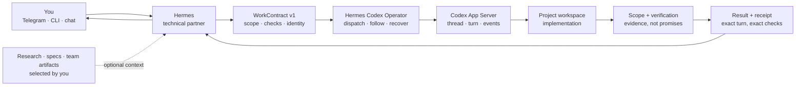
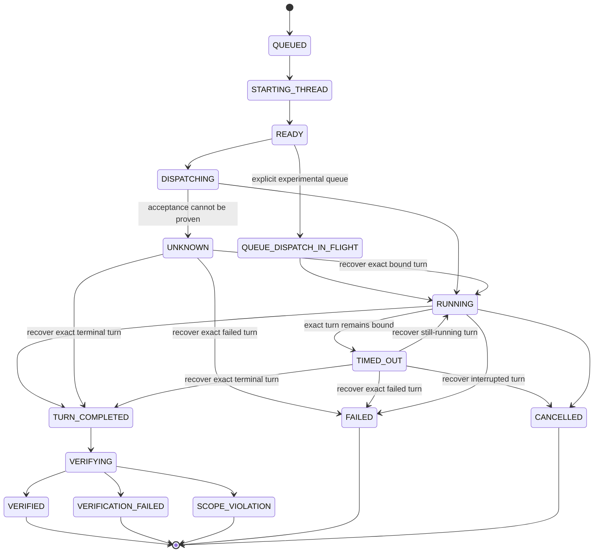

<p align="center">
  
</p>

<h1 align="center">Hermes Codex Operator</h1>

<p align="center">
  <a href="https://github.com/AlekseiUL/hermes-codex-operator/actions/workflows/ci.yml"></a>
  <a href="LICENSE"></a>
</p>

<p align="center"><strong>Talk to Hermes. Ship with Codex.</strong></p>

<p align="center">
  A small, local-first bridge between Nous Research's Hermes Agent and OpenAI
  Codex CLI/App Server. It turns plain-language ideas into tracked, verified
  Codex work—planned by Hermes, executed by Codex, and explained back to you.
</p>

<p align="center">
  <a href="#english">English</a> · <a href="#русский">Русский</a>
</p>

<a id="english"></a>

## English

## The idea

You should not need to be a programmer—or an expert prompt writer—to get high
quality work from Codex.

Tell Hermes what you want in ordinary language. Hermes acts as the technical
partner: it clarifies only what matters, proposes architecture and trade-offs,
decomposes the work, and creates a precise engineering brief. Hermes Codex
Operator then owns the fragile middle of the journey: dispatching one exact
Codex turn, keeping its identity, following it to completion, reading the
authoritative result, checking the workspace, and returning evidence.

Codex does the implementation. Hermes stays in the conversation. You get the
result—and a clear explanation of what happened and what to do next.



## Why this is useful

- **A technical partner before coding.** The bundled Hermes skill turns a rough
  idea into architecture, options, a decomposition, acceptance criteria, and a
  Codex-ready task.
- **One task stays one task.** Stable task, operation, thread, and turn IDs keep
  follow-ups in the right Codex context.
- **No silent double-submit.** If dispatch becomes ambiguous, the operation is
  marked `UNKNOWN`; the prompt is not sent again automatically.
- **Completion is checked.** Codex's final message is read from the exact turn,
  then declared commands and changed-file scope are verified independently.
- **Restarts do not erase ownership.** A private SQLite journal plus the exact
  retained WorkContract support status, recovery, collection, and continuation.
- **The answer comes back in human language.** Hermes can explain the result,
  blockers, evidence, and best next step through the channel you already use.

The project is deliberately two small pieces, not another giant orchestrator:

1. `hermes-codex`, a small Python lifecycle CLI for Codex App Server, with one
   pinned runtime dependency (`websockets`) for the managed Unix-socket queue;
2. `skills/hermes-codex-operator`, a lightweight Hermes skill that teaches the
   agent how to plan, dispatch, monitor, verify, and report.

The wheel intentionally contains the core CLI only. The repository and source
distribution contain both pieces; until a dedicated skill installer exists,
use a source checkout for the complete Hermes integration shown below.

## A normal conversation

> **You:** I have a product idea, but I do not know how to structure the code
> or write a good Codex prompt.
>
> **Hermes:** I will turn the idea into a small architecture, point out the
> important choices, split the work into a verifiable first milestone, and
> send that milestone to Codex.
>
> **Later, in Telegram:** The Codex task is complete. It changed two files, all
> declared checks passed, and the result was read back from the exact task. Here
> is what was built, what it means in plain language, and the best next step.

When Hermes owns the Telegram conversation, no Telegram code is needed in this
repository: the foreground operator returns a structured result and Hermes
sends the final message through its existing channel. Completion events for an exact manually started turn are stored durably in a
transport-neutral local outbox. Delivery remains the host application's job.

## What is available today

| Capability | Current source status |
|---|---|
| Clarify an idea; propose architecture, options, decomposition, and acceptance criteria | Included in the Hermes skill |
| Start a new Codex task | Implemented in the core |
| Continue one exact existing idle task once | Implemented as the explicit `continue` command |
| Queue one exact active loaded task once | Experimental `queue`; the CLI requires the same already-running managed App Server and exact Codex 0.149.0 |
| Wait for the exact turn, read it authoritatively, and return the result | Implemented in the core |
| Verify changed-file scope and argv-only checks | Implemented in the core |
| Durable status, conservative recovery, immutable receipts | Implemented in the core |
| Explain the result and send it through Telegram or another Hermes channel | Provided by the host Hermes agent |
| Add selected research or team artifacts to a brief | Supported as a Hermes workflow; automatic cross-agent crawling is not included |
| Catalog threads and watch an exact manually started turn | Implemented read-only with durable completion events |
| Create visible Codex Desktop projects and tasks | Roadmap: optional, version-gated desktop adapter |
| Background daemon, Kanban, general multi-agent routing, or multi-harness execution | Intentionally not included |

This table is a product contract: the README does not advertise roadmap items
as finished features.

For the exact evidence behind each claim, read
[Quality and reliability](docs/QUALITY.md). It separates synthetic CI, live
Codex qualification, stable surfaces, experimental surfaces, and explicit
non-guarantees.

## Quick start

Requirements:

- Python 3.11 through 3.14;
- an installed and authenticated Codex CLI with App Server support;
- Hermes Agent only if you want the conversational agent workflow.

`python -m pip install .` installs the pinned `websockets==15.0.1` dependency
used by the experimental managed-daemon queue path.
Confirm that the interpreter used to create the environment is in range—for
example, `python3 --version` must not report the macOS system Python 3.9.

Clone the repository and install the core CLI:

```bash
git clone https://github.com/AlekseiUL/hermes-codex-operator.git
cd hermes-codex-operator
python3 -m venv .venv
. .venv/bin/activate
python -m pip install .
hermes-codex doctor --json
```

`doctor` is a shallow local preflight: it checks the Python runtime and that
the `codex` executable reports a version. It does not prove authentication,
configuration validity, or a successful App Server turn; use the explicit live
smoke in [COMPATIBILITY.md](docs/COMPATIBILITY.md) for that.

Create a `WorkContract` with an absolute workspace path. The included
[synthetic example](examples/work-contract.json) is safe to copy and edit:

```json
{
  "schema_version": "1",
  "task_id": "widget-health",
  "operation_id": "widget-health-001",
  "workspace": "/absolute/path/to/widget",
  "prompt": "Add a health endpoint, cover it with tests, and report the changed files.",
  "allowed_change_globs": ["src/**", "tests/**"],
  "verification": [["python3", "-m", "unittest", "discover", "-s", "tests"]],
  "timeout_seconds": 900
}
```

The contract is private operational input: it contains the raw prompt and an
absolute workspace path. Keep the exact file outside Git and outside the target
workspace, set mode `0600` on POSIX, and retain it beside the private journal
until completion. Losing or editing it prevents safe recovery by design because
the journal stores only its digest, not the raw prompt.

Submit it once from an allowlisted parent directory:

```bash
hermes-codex submit \
  --contract work-contract.json \
  --allow-root /absolute/path/to/projects \
  --json
```

Inspect, reconcile, or collect the same operation without creating another
turn:

```bash
hermes-codex status widget-health-001 --json
hermes-codex recover --contract work-contract.json --allow-root /absolute/path/to/projects --json
hermes-codex collect --contract work-contract.json --allow-root /absolute/path/to/projects --json
```

Read-only catalog and exact-ID watch commands never resume or start Codex work:

```bash
hermes-codex catalog --json
hermes-codex catalog read THREAD_ID --json
hermes-codex catalog read THREAD_ID --include-result --json
hermes-codex adopt THREAD_ID TURN_ID --json
hermes-codex watch WATCH_ID --json
hermes-codex events list --json
hermes-codex events ack EVENT_ID --json
```

`catalog` is bounded to 20 pages and 1,000 threads. `catalog read` performs an
exact read-only `thread/read` and exposes turn IDs plus result digests; raw
result text requires explicit `--include-result`. `adopt` requires both exact
IDs and verifies them through `thread/read`. Watches survive process restart;
one terminal watch creates exactly one event containing the result digest, not
the raw result. Missing, duplicate, or conflicting identity becomes `UNKNOWN`
without dispatch. Event acknowledgement is idempotent. There is no daemon or
delivery transport in the package, so callers poll `watch` and consume the
outbox themselves.

For a follow-up, keep `task_id` and use a new `operation_id`. That resumes the
same Codex thread. Never reuse an operation ID with different instructions.

To continue a task discovered outside this journal, pin the exact idle thread
and expected workspace in a private WorkContract, then invoke the distinct
mutation command once:

```bash
hermes-codex continue \
  --contract work-contract.json \
  --thread-id THREAD_ID \
  --allow-root /absolute/path/to/projects \
  --json
```

`continue` first reserves the operation, reads and verifies the exact idle
thread/workspace, and persists the complete baseline turn-ID set. Only then may
it issue one `thread/resume` and one `turn/start`. The returned turn must be the
only new turn and is bound atomically. A lost, malformed, mismatched, or
ambiguous resume/start result becomes `UNKNOWN`; repeating the same operation
returns `dispatched=false` and never submits again. Raw final text is returned
only by this explicit mutation invocation or the existing explicit `collect`
and `catalog read --include-result` surfaces.

The shared-queue path is a separate experimental mutation, never a fallback
from `continue`. A standalone CLI process cannot own an active task from some
other App Server process. Start Codex's managed App Server explicitly and ensure
the active task is loaded there:

```bash
codex app-server daemon start
```

Then request the exact allowlisted version:

```bash
hermes-codex queue \
  --contract work-contract.json \
  --thread-id THREAD_ID \
  --shared-app-server \
  --experimental-api-version 0.149.0 \
  --allow-root /absolute/path/to/projects \
  --json
```

Stable commands initialize App Server with `experimentalApi: false`. The queue
CLI refuses to run without `--shared-app-server`; that flag reads `socketPath`
and `appServerVersion` from `codex app-server daemon version`, requires exact
Codex 0.149.0, and connects directly to `/rpc` on that Unix socket with
`websockets`. It never accepts an arbitrary transport command.
`queue` opts into `experimentalApi: true`, proves that the exact active thread
is loaded in that managed server, verifies its exact `0.149.0` runtime evidence,
stores the message and baseline-turn digests, and enqueues once. A lost or
malformed enqueue response gets one bounded queue inspection and no retry;
zero, multiple, duplicated, or mismatched candidates become `UNKNOWN`. Queue
disappearance is not completion: the resulting turn must carry the exact queued
client-message ID and normalized-input digest, followed by authoritative
completed exact-turn readback. Because completion notifications may be
connection-local, owner and target completion are proven with bounded exact
`thread/read` polling; a notification/readback disagreement fails closed. Active
queues can be consumed automatically by Codex after the owner turn becomes
terminal; `thread/queue/start` is used only after a bounded readback still shows
the exact submission queued. Both automatic consumption and the manual fallback
have synthetic coverage. On 2026-08-26 the public managed-daemon CLI path
passed an opt-in macOS arm64 live smoke against Codex `0.149.0`: one submission
reached exact verified readback and a restarted invocation returned
`dispatched=false`. That evidence does not identify which consumption branch
Codex used, and every other Codex version or operating system requires separate
qualification.

Generic `recover` and `collect` deliberately cannot promote a stuck queue
operation to success. Repeating it only observes durable state. The simple
human escape hatch is `abandon`: it can close any open queue operation and a
continuation that failed before authoritative turn correlation. It permits a
later operation, but does not prove that already-dispatched remote work
stopped. A correlated continuation timeout keeps its authoritative recovery
path and cannot be abandoned.

Experimental `queue` verification is deliberately end-state evidence, not
per-turn filesystem attribution. Its workspace baseline is captured while the
selected owner turn is still active, so receipt `changed_paths` may include
changes from that owner or another concurrent writer as well as the queued turn.
The exact queued input, resulting turn, final response, scope, and final checks
are verified; the receipt does not claim which turn caused each file change. Use
idle `continue`, or a demonstrably non-mutating owner, when causal isolation is
required.

For lifecycle commands, JSON `ok` means the operation is `VERIFIED`. `status`
still exits `0` when it successfully reads a non-verified record, so automation
must inspect both `status` and `ok`. Invocation/configuration errors exit `2`;
a lifecycle command that finishes without verification exits `3`.

## Add the Hermes skill

Hermes discovers skills from `$HERMES_HOME/skills/` (normally
`~/.hermes/skills/`; profiles use their own Hermes home). From the checkout:

```bash
HERMES_HOME="${HERMES_HOME:-$HOME/.hermes}"
mkdir -p "$HERMES_HOME/skills"
cp -R skills/hermes-codex-operator "$HERMES_HOME/skills/"
hermes skills list
```

Start a new Hermes session after installing the skill, then speak normally or
invoke `/hermes-codex-operator`. The skill stays compact; the detailed role and
configuration recipes live in the
[agent playbook](docs/AGENT_PLAYBOOK.md).

## Reliability model

One `operation_id` represents at most one logical Codex turn.



`TURN_COMPLETED` is not the same as `VERIFIED`. A verified receipt binds the
prompt digest, workspace digest, exact Codex thread and turn, authoritative
result digest, changed paths, and verification evidence.

Explicit `abandon` is a local-only escape hatch for a stuck queue operation or
an uncorrelated continuation. It is unavailable when a continuation has an
exact recoverable turn, and never claims that remote work was cancelled.

The operator is evidence enforcement, not an operating-system sandbox. Codex's
sandbox remains its execution boundary. Declared verification argv is trusted
caller-selected code and runs as the operator's OS user, outside the Codex
sandbox; `shell=false`, time/output bounds, and post-hoc workspace scope checks
do not prevent that command from writing elsewhere. Use only reviewable,
project-local checks you would run yourself.

## Privacy by construction

- no telemetry;
- no raw prompt or model response in the journal or receipt by default;
- no private Hermes profile, Telegram token, chat ID, team name, or local
  project copied into the repository;
- synthetic fixtures only;
- repository tree, staged index, Git history, and release archive privacy
  gates;
- deterministic sdist normalization removes local account names from tar owner
  metadata before publication;
- local runtime state is ignored and stored with private permissions.

Read [SECURITY.md](SECURITY.md), the
[threat model](docs/THREAT_MODEL.md), and the
[privacy release procedure](docs/PRIVACY_RELEASE.md) before deployment or
publication.

## Project status

The latest published tag is `v0.0.1`. The current source tree is a pre-alpha
`v0.1.0` candidate, not a claim that `v0.1.0` has been released. Its protocol
and failure behavior have a comprehensive scripted suite, while live
compatibility is qualified separately for each Codex CLI, Hermes, Python, and
OS combination. Unqualified combinations are targets, not support claims. See
[QUALITY.md](docs/QUALITY.md), [COMPATIBILITY.md](docs/COMPATIBILITY.md), and
[ROADMAP.md](docs/ROADMAP.md).

The integration uses the official
[Codex App Server protocol](https://developers.openai.com/codex/app-server),
which provides threads, turns, streamed lifecycle events, and authoritative
thread reads. Hermes skills follow the current
[Hermes Agent skills system](https://github.com/NousResearch/hermes-agent/blob/main/website/docs/user-guide/features/skills.md).

## Development

```bash
PYTHONPATH=src PYTHONWARNINGS=error::ResourceWarning \
  python3 -m unittest discover -s tests
python3 scripts/privacy_gate.py . --mode tree
```

The baseline lifecycle is in [RFC-0001](docs/RFC-0001.md); current observation,
continuation, and shared-queue semantics are in
[RFC-0002](docs/RFC-0002.md).
Contributor setup is in [CONTRIBUTING.md](CONTRIBUTING.md). Independent review
findings are recorded in [REVIEWS](docs/REVIEWS.md).

## Creator and useful links

- [Aleksei Ulianov on GitHub](https://github.com/AlekseiUL)
- [Aleksei Ulianov on YouTube](https://youtube.com/@alekseiulianov)
- [Sprut AI Telegram channel](https://t.me/Sprut_AI)
- [Sprut AI Telegram community chat](https://t.me/+eH-qNIDmud8zNDZi)
- [AI Операционка](https://t.me/tribute/app?startapp=sJyg)
- [Hermes Agent](https://github.com/NousResearch/hermes-agent)
- [OpenAI Codex](https://github.com/openai/codex)

## License and trademarks

MIT. This is an independent community project. It is not affiliated
with or endorsed by OpenAI or Nous Research. Hermes Agent and Codex are names
of their respective projects and products.

---

<a id="русский"></a>

## Русский

### Что это

Hermes Codex Operator - локальная прослойка между
[Hermes Agent](https://github.com/NousResearch/hermes-agent) и Codex CLI / App
Server. Вы формулируете задачу обычным языком. Hermes помогает уточнить цель,
границы и критерии приёмки. Codex пишет код. Operator сохраняет точную связь с
потоком и запуском Codex, ждёт завершения, перечитывает итог и проверяет
рабочую папку.

Проблема, которую решает проект, простая: сообщения Codex о завершении мало.
Нужно знать, какой именно запуск выполнился, что он изменил, какие проверки
реально прошли и не отправилась ли одна задача дважды.

### Что уже работает в текущем исходном коде

- новый запуск Codex и продолжение того же контекста;
- отдельная экспериментальная команда `queue` для однократной постановки
  точной активной задачи через уже запущенный управляемый App Server Codex,
  с флагом `--shared-app-server` и точным opt-in `0.149.0`;
- постоянные идентификаторы задачи, операции, потока и запуска;
- защита от автоматической повторной отправки при неоднозначном результате;
- точное чтение финального ответа через `thread/read`;
- проверка изменённых файлов по разрешённым шаблонам;
- команды проверки в виде массива аргументов, без запуска через shell;
- приватный SQLite-журнал для статуса и восстановления;
- неизменяемый receipt с хешами и результатами проверок;
- отдельный Hermes skill для подготовки, запуска, контроля и объяснения
  результата.
- ограниченный каталог потоков, read-only подключение по точным `threadId` и
  `turnId`, постоянные watches и локальный outbox событий завершения;

Для экспериментальной `queue` список изменённых файлов описывает общее конечное
состояние за время активной исходной и поставленной в очередь задач. Он не
доказывает, какой именно запуск изменил каждый файл. Если нужна причинная
изоляция изменений, используйте `continue` для уже свободной задачи или
исходный активный запуск, который гарантированно не меняет рабочую папку.

Operator не является фоновым диспетчером, полноценной песочницей или заменой
человеческой приёмки. Он может наблюдать только точный уже известный поток и
запуск через App Server; Desktop Projects и управление интерфейсом не входят в
пакет.

### Быстрый старт

Требования:

- Python 3.11-3.14;
- установленный и авторизованный Codex CLI с App Server;
- Hermes Agent, если нужен разговорный сценарий.

Команда `python -m pip install .` автоматически установит закреплённую
зависимость `websockets==15.0.1`, которая нужна экспериментальной очереди через
управляемый App Server.
Перед созданием окружения проверьте `python3 --version`: системный Python 3.9 в
старых версиях macOS для проекта не подходит.

```bash
git clone https://github.com/AlekseiUL/hermes-codex-operator.git
cd hermes-codex-operator
python3 -m venv .venv
. .venv/bin/activate
python -m pip install .
hermes-codex doctor --json
```

Создайте приватный `WorkContract`. Синтетический пример лежит в
[`examples/work-contract.json`](examples/work-contract.json). В контракте
задаются рабочая папка, промпт, разрешённые файлы, команды проверки и тайм-аут.

```bash
hermes-codex submit \
  --contract work-contract.json \
  --allow-root /absolute/path/to/projects \
  --json
```

Для той же операции используйте `status`, `recover` или `collect`. Не создавайте
новый запуск, если состояние стало `UNKNOWN` или `TIMED_OUT`: Operator специально
сохраняет неоднозначность и требует сверить точный поток и запуск.

### Подключение skill к Hermes

```bash
HERMES_HOME="${HERMES_HOME:-$HOME/.hermes}"
mkdir -p "$HERMES_HOME/skills"
cp -R skills/hermes-codex-operator "$HERMES_HOME/skills/"
hermes skills list
```

После установки начните новую сессию Hermes и говорите с агентом обычным
языком или вызовите `/hermes-codex-operator`.

### Модель надёжности

Один `operation_id` соответствует максимум одному логическому запуску Codex.
Если Operator не может доказать, что запрос был принят или не принят, операция
получает статус `UNKNOWN`. Повторная отправка автоматически не выполняется.

`TURN_COMPLETED` ещё не означает `VERIFIED`. Для подтверждённого результата
Operator связывает хеш промпта, рабочую папку, точный поток и запуск Codex,
авторитетно перечитанный ответ, список изменений и результаты проверок.

Экспериментальная очередь не запускается через новый отдельный App Server:
сначала явно запустите `codex app-server daemon start`, а в `hermes-codex queue`
передайте `--shared-app-server`. Зависшую очередь обычные `recover` и `collect`
не превращают в успех; явный `abandon` закрывает только локальную операцию и не
утверждает, что удалённая работа остановилась. Для уже точно связанного
продолжения сохраняется безопасный `recover`, поэтому такое продолжение нельзя
закрыть через `abandon`.

Команды проверки выбирает пользователь. Они запускаются от имени текущего
пользователя операционной системы и могут иметь побочные эффекты. Используйте
только понятные проектные команды, которые вы готовы запустить вручную.

### Приватность

- телеметрии нет;
- исходный промпт и ответ модели по умолчанию не попадают в журнал и receipt;
- тесты используют только синтетические данные и временные папки;
- privacy gate проверяет дерево, Git index, достижимую историю, sdist и wheel;
- метаданные sdist нормализуются перед публикацией, чтобы локальное имя
  пользователя не попало в архив.

Подробности: [политика безопасности](SECURITY.md),
[модель угроз](docs/THREAT_MODEL.md),
[процедура публикации](docs/PRIVACY_RELEASE.md) и
[совместимость](docs/COMPATIBILITY.md). Честная матрица гарантий, проверок и
ограничений собрана в [QUALITY.md](docs/QUALITY.md).

### Автор и ресурсы

- [Алексей Ульянов на GitHub](https://github.com/AlekseiUL)
- [Алексей Ульянов на YouTube](https://youtube.com/@alekseiulianov)
- [Telegram-канал Sprut AI](https://t.me/Sprut_AI)
- [Telegram-чат сообщества](https://t.me/+eH-qNIDmud8zNDZi)
- [AI Операционка](https://t.me/tribute/app?startapp=sJyg)
- [Hermes Agent](https://github.com/NousResearch/hermes-agent)
- [OpenAI Codex](https://github.com/openai/codex)

Проект распространяется по лицензии MIT. Это независимый проект
сообщества, не связанный официально с OpenAI или Nous Research и не одобренный
ими.
