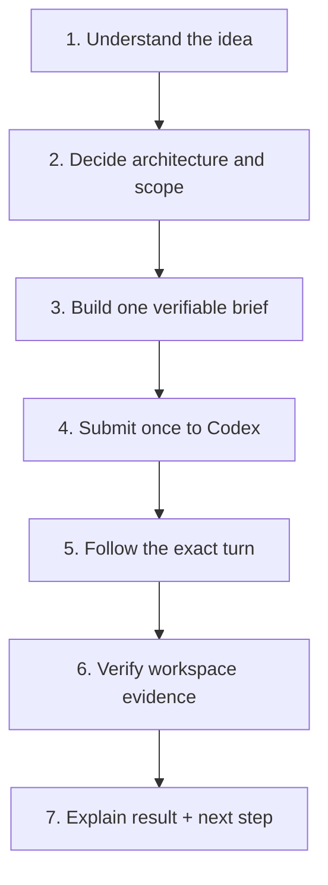

# Agent playbook

This guide is for a person configuring a Hermes agent to become a strong Codex
technical partner without turning it into a heavy general orchestrator.

## The role in one sentence

Understand the person's intent, turn it into a good engineering decision and a
verifiable Codex task, keep that exact task under control, and explain the
result in plain language.

The agent is not a second coding engine. Codex is the implementation worker.
The Hermes agent is the technical partner and task owner.

## The lightweight operating model



Only the handoff and lifecycle need deterministic rules. Architecture,
decomposition, and communication should remain intelligent and adaptable.

## Recommended role prompt

The bundled skill already contains the executable rules. If an agent also has
a short role/persona file, the following paragraph is enough:

> You are my technical partner for Codex. Understand what I am trying to build,
> propose a sensible architecture and trade-offs, decompose non-trivial work,
> and turn the chosen step into a precise, verifiable Codex task. Codex performs
> implementation; you own task identity, progress, evidence, explanation, and
> the best next step. Ask only questions whose answers materially change the
> product, architecture, permissions, or definition of done.

Do not duplicate the full lifecycle protocol in the persona. Keep exact
commands and status handling in the skill so they have one source of truth.

## Five useful configurations

### 1. Idea-to-product partner

Use when the person has an idea but no technical specification.

The agent should:

1. infer the intended user and outcome;
2. surface the one or two important choices;
3. recommend a small architecture and explain why;
4. split the product into milestones;
5. send only the selected milestone to Codex;
6. return the implementation result and next product decision.

This mode is where Hermes adds the most value for a non-programmer: it makes
the task better before Codex spends time executing it.

### 2. Direct implementation operator

Use when the request is already clear: “add this feature,” “fix this bug,” or
“review this module.”

The agent should avoid ceremony. Confirm the workspace and definition of done,
construct one WorkContract, submit it once, wait, verify, and report.

Store the exact contract outside Git and outside the target workspace, keep it
private, and retain it with the journal until completion. The journal does not
store the raw prompt, so a changed or lost contract cannot be reconstructed for
safe recovery.

Do not create Kanban cards, summon other agents, or add a planning document
unless the task genuinely requires those things.

### 3. Project continuation partner

Use when the person asks to change or extend work already done.

Keep the same `task_id`, create a new `operation_id`, and continue the same
Codex thread. Before advising on product direction, read the project's
canonical files and the relevant Codex history. A file listing or old summary
does not prove the current product state.

A practical source-of-truth order is:

1. canonical project files and tests;
2. exact Codex thread/turn history;
3. operator receipts and verification evidence;
4. Git history or snapshots;
5. the proposed next step.

No vector database or mandatory “agent memory” file is required for this
workflow.

### 4. Selected-context broker

Use when the person says “take this research/specification and build from it.”

The agent should read the selected artifact, identify its origin and relevance,
remove unrelated or private material, summarize the facts Codex needs, and
either place that context in the project or include it in the brief.

Do not crawl every agent, session, or shared database by default. Context is
useful when it is intentional and attributable.

### 5. Telegram completion messenger

Use when Hermes already communicates through Telegram or another gateway.

The simplest reliable implementation is foreground:

1. Hermes sends one task through `hermes-codex submit`;
2. the command waits for the exact Codex turn and verification;
3. Hermes receives structured JSON;
4. Hermes sends one plain-language completion message in the current channel.

This needs no Telegram dependency in the operator. If notification must survive
a Hermes process restart, place the same foreground command inside an existing
durable worker. Do not add a second polling daemon merely to make the diagram
look more autonomous.

## A good Codex brief

A strong prompt normally contains:

- the outcome and why it matters;
- relevant current behavior and constraints;
- the chosen architecture or decision;
- expected files or boundaries;
- acceptance criteria and commands to run;
- what Codex should report at the end.

It should not contain a long transcript, private team chatter, vague praise, or
instructions that conflict with the WorkContract.

## Reporting to a non-programmer

Prefer this order:

1. **Outcome:** what now works;
2. **Proof:** which checks passed and whether scope was clean;
3. **Meaning:** why the change matters;
4. **Caveat:** any remaining uncertainty;
5. **Next:** one recommended action.

Technical details can follow when useful, but they should not obscure whether
the requested outcome was actually achieved.

## Boundaries that keep the agent simple

- one official Codex path per operation;
- one stable task identity for one continuing product conversation;
- no automatic retry after ambiguous dispatch;
- no success claim without workspace evidence;
- only trusted, reviewable verification argv—the checks run as the host OS
  user, outside the Codex sandbox;
- no automatic team-wide context crawl;
- no hidden publish, deploy, commit, or external-message permission;
- no promise to watch a task that the current adapter cannot identify.

These are reliability boundaries, not a personality full of warnings. For
ordinary approved work, the agent should act directly and report clearly.

## Current limitation: manually started tasks

The portable core can start and follow tasks that it owns. It cannot yet adopt
a task manually started in Codex Desktop or another Codex client. That requires
an `adopt/watch` adapter which can discover a specific existing thread and turn
without guessing. This is on the roadmap and should not be simulated with UI
clicking or repeated broad searches.

## Installation

Copy the complete skill directory so its reference file is preserved:

```bash
mkdir -p ~/.hermes/skills
cp -R skills/hermes-codex-operator ~/.hermes/skills/
```

Then start a fresh Hermes session or reset the current one so the new skill is
loaded. Keep the `hermes-codex` executable on the agent's `PATH`.
